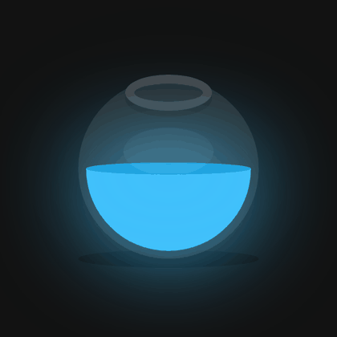

# Potion

Animação de um frasco de poção feita **apenas com HTML e CSS**, sem JavaScript: o frasco balança, o líquido se move lá dentro e a cor muda continuamente.

🔗 **Demo:** [evssousa.github.io/potion](https://evssousa.github.io/potion)

<p align="center">
  
</p>

## O que tem de interessante

- Animação em loop infinito de 5 segundos
- Frasco que balança de um lado para o outro, com o líquido se movendo em sentido contrário
- Cor do líquido e do brilho que percorre todo o espectro (azul, rosa, laranja, verde...)
- Brilho (glow) ao redor do frasco e sombra no chão
- Zero JavaScript e zero dependências: só dois arquivos

## Tecnologias

- **HTML5**: estrutura mínima (um frasco e um líquido)
- **CSS3**: todo o desenho e a animação

## Técnicas de CSS usadas

| Técnica | Onde aparece |
| --- | --- |
| `@keyframes` + `animation` | movimento do frasco e do líquido |
| `filter: hue-rotate()` | mudança contínua de cor |
| `filter: drop-shadow()` | brilho do líquido |
| Pseudo-elementos `::before` e `::after` | boca do frasco, reflexo e superfície do líquido |
| `border-radius` | formato arredondado do frasco e do líquido |
| `transform-origin` | pivô da rotação (base do frasco e topo do líquido) |
| Flexbox | centralização do frasco na tela |

## Estrutura do projeto

```
potion/
├── img/
│   └── preview.gif   # animação usada neste README
├── index.html        # estrutura da página
├── style.css         # desenho e animações
└── README.md
```

## Como rodar localmente

Não precisa instalar nada. Clone o repositório e abra o arquivo no navegador:

```bash
git clone https://github.com/evssousa/potion.git
cd potion
```

Depois, abra o `index.html` no navegador (duplo clique no arquivo ou, no VS Code, use a extensão Live Server).

## Como funciona

O frasco (`.bowl`) é um círculo semitransparente que gira em torno da base, e o líquido (`.liquid`) é um bloco azul dentro dele que gira em torno do topo, em sentido oposto. É essa combinação que dá a impressão de líquido balançando.

A mudança de cor vem de um único `hue-rotate` aplicado ao frasco inteiro, que vai de `0deg` a `360deg` ao longo dos mesmos 5 segundos do loop. Por isso o brilho e o líquido mudam juntos, sem precisar definir cada cor.

## Ideias de melhorias futuras

- Adicionar bolhas subindo no líquido
- Ajustar o tamanho do frasco para telas pequenas (hoje ele tem largura fixa de 300px)
- Criar um botão para pausar a animação ou escolher a cor
- Respeitar `prefers-reduced-motion` para quem prefere menos movimento

## Autor

**Everson Sousa**, Análise e Desenvolvimento de Sistemas

[](https://github.com/evssousa)
[](https://linkedin.com/in/evssousa)
